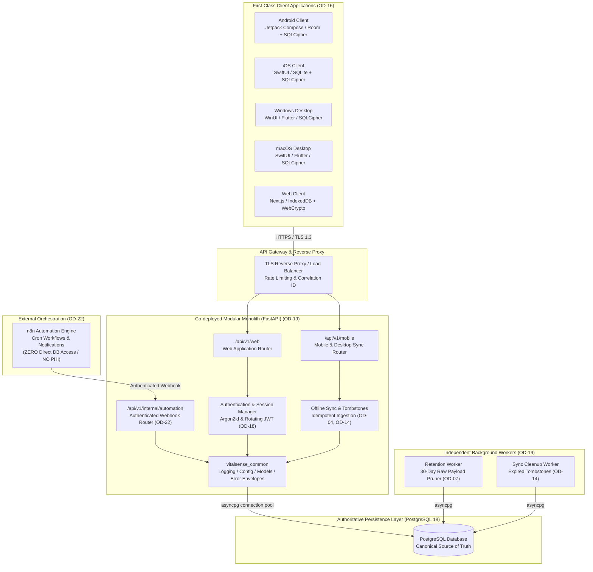
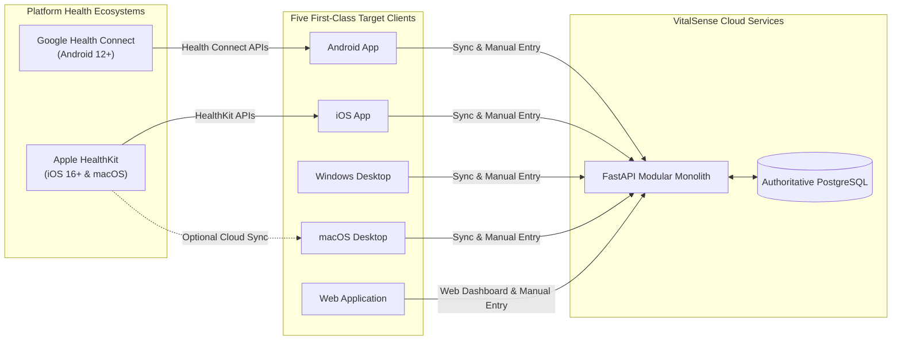
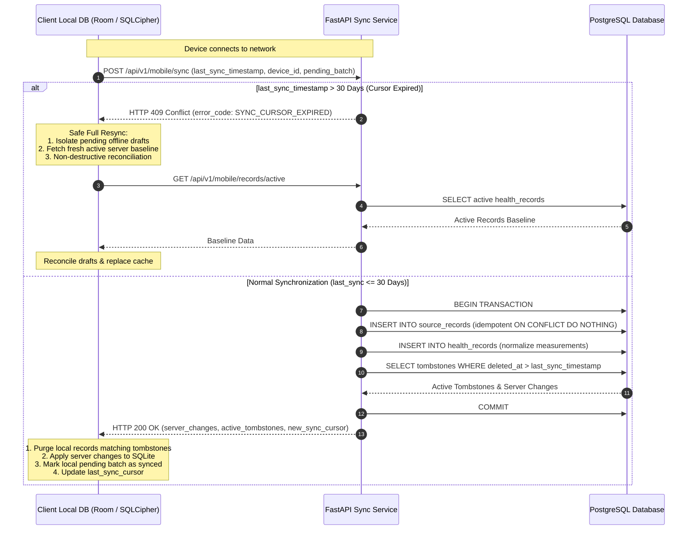
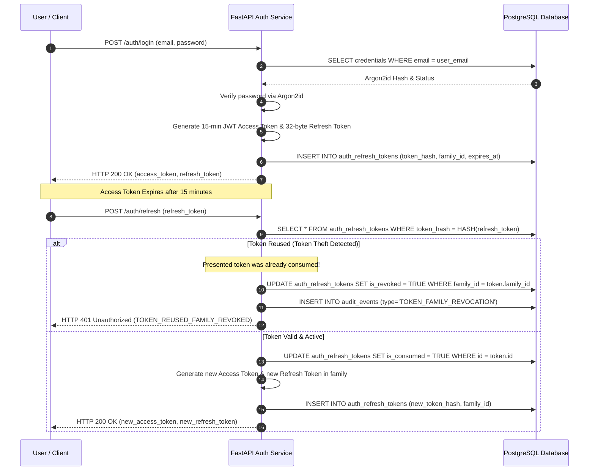
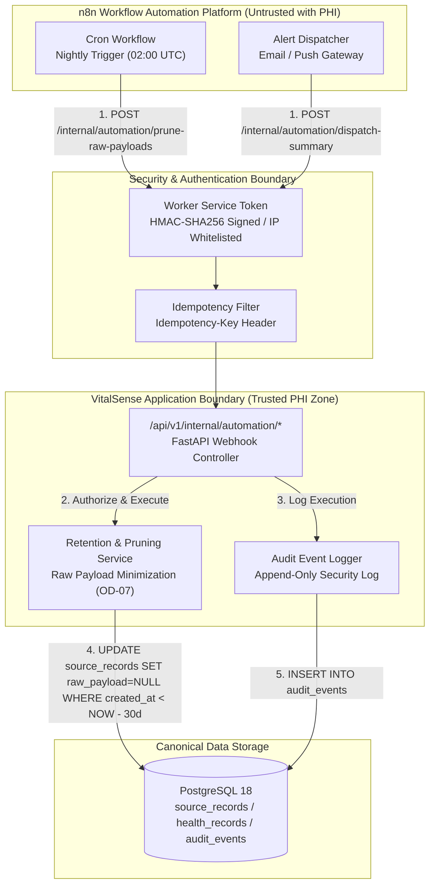

# VitalSense — System Architecture Blueprint & Technical Design

**Document Version:** 1.0.0  
**Status:** **AUTHORITATIVE ARCHITECTURE BASELINE**  
**Governing Milestone:** Milestone 0.6 (Architecture Consolidation & Decision Finalization)  
**Approved Decisions Integrated:** `OD-01`, `OD-03`, `OD-04`, `OD-07`, `OD-14`, `OD-16`, `OD-17`, `OD-18`, `OD-19`, `OD-22`  
**Active Specifications:** [VitalSense_SRS_v1.1.1_Merged.md](file:///e:/Projects/VITALSENSE/docs/VitalSense_SRS_v1.1.1_Merged.md) | [VitalSense_PRD_v1.1.md](file:///e:/Projects/VITALSENSE/docs/VitalSense_PRD_v1.1.md)  

---

## 1. System Overview & Architectural Principles

VitalSense is a privacy-conscious, multi-platform personal health and wellness platform designed to aggregate, normalize, securely persist, and present personal health observations across five client form factors.

### 1.1 Core Architectural Principles
1. **Canonical Server Authority:** The PostgreSQL database is the single authoritative source of truth for all synchronized health records, metric definitions, user accounts, and security audit logs (`DATA-004`).
2. **Offline-First Client Operation:** Local client databases function as secure, offline-accessible viewing caches and durable operation queues. Users can record manual entries or browse historical data without network connectivity (`SYNC-001`).
3. **Five First-Class Platforms:** Android, iOS, Windows, macOS, and Web are first-class targets planned and developed in parallel with independent native release pipelines (`OD-16`).
4. **Strict Medical & Wellness Boundary:** Under general wellness scope, VitalSense does not diagnose disease or prescribe treatment. Missing or delayed device data must be honestly rendered as empty states; **zero values are never fabricated** (`OD-01`).
5. **Defense-in-Depth Privacy & Encryption:** Local health records are encrypted at rest across all five platforms using platform-appropriate secure key storage (`OD-17`). Identifiable health data (PHI) never leaves application boundaries (`OD-22`).

---

## 2. Five-Platform Client Architecture

VitalSense targets five independent client applications developed in parallel, sharing common data models, API contracts, and synchronization semantics:

```text
apps/
├── android/            # Android Client (Kotlin / Jetpack Compose / Room + SQLCipher)
├── ios/                # iOS Client (Swift / SwiftUI / HealthKit / SQLite + SQLCipher)
├── desktop-windows/    # Windows Desktop Client (C# / WinUI 3 or Cross-Platform Flutter Desktop)
├── desktop-macos/      # macOS Desktop Client (Swift / SwiftUI or Cross-Platform Flutter Desktop)
└── web/                # Web Application (Next.js / TypeScript / Tailwind CSS / IndexedDB + Web Crypto)
```

### 2.1 Platform Support Matrix & Data Ingestion Capabilities

| Platform | Target Architecture / OS | Native Health Ingestion Source | Local Persistence & Encryption | Key Management Mechanism |
| :--- | :--- | :--- | :--- | :--- |
| **Android** | Android 12.0+ (API 31+), ARM64 / x86_64 | **Google Health Connect** (Background & foreground sync) | **Room** with **SQLCipher** (256-bit AES) | Hardware-backed **Android KeyStore** via `EncryptedSharedPreferences` |
| **iOS** | iOS 16.0+, ARM64 | **Apple HealthKit** (Background observer queries) | **SQLite** with **SQLCipher** (256-bit AES) | Hardware-backed **iOS Keychain** (`kSecAttrAccessibleAfterFirstUnlockThisDeviceOnly`) |
| **Windows** | Windows 10/11 (Build 19041+), x64 / ARM64 | Consumes synchronized cloud data (no phone sensors) | **SQLite** with **SQLCipher** (256-bit AES) | **Windows Data Protection API (DPAPI)** / Credential Locker |
| **macOS** | macOS 13.0+ (Ventura), Apple Silicon & Intel | Consumes synchronized cloud data; optional HealthKit | **SQLite** with **SQLCipher** (256-bit AES) | **macOS Keychain** services |
| **Web** | Modern Evergreen (Chrome 115+, Firefox 115+, Safari 16+, Edge 115+) | Consumes synchronized cloud data & manual entry | **IndexedDB** encrypted via **Web Crypto API** (AES-GCM-256) | Protected in-memory session key derived from authenticated token context |

### 2.2 Desktop Technology Evaluation & Trade-offs
- **Desktop Strategy:** Desktop applications primarily consume and visualize synchronized health data. Desktop environments do not have native pedometers or optical heart-rate monitors, so **no physical sensors are fabricated on desktop platforms**.
- **Framework Options Considered:**
  1. *Flutter Desktop (Dart):* Excellent single-codebase coverage for Windows, macOS, and Linux; high-performance Skia/Impeller rendering; robust SQLCipher bindings (`sqlite3_flutter_libs`).
  2. *Tauri (Rust + Web Frontend):* Ultra-lightweight memory footprint (<40MB); leverages OS webview; secure Rust backend bindings for DPAPI/Keychain.
  3. *Native WinUI 3 (C#) & SwiftUI (macOS):* Best platform feel, highest accessibility conformance, but requires maintaining two distinct desktop codebases.
- **Architectural Directive:** Phase 1 desktop client prototypes will utilize **Flutter Desktop** or **Tauri** to maximize cross-platform code sharing with the mobile/web architectures while ensuring native SQLCipher encryption.

---

## 3. Modular Monolith Backend Architecture

The backend is architected as a **Co-deployed Modular Monolith** using **FastAPI** and **SQLAlchemy 2.0 (asyncio)** connecting to a central **PostgreSQL** instance (`OD-19`).

```text
services/
├── api/                        # Central FastAPI Modular Monolith entrypoint (main.py)
├── web_api/                    # Web API Router Namespace (/api/v1/web)
├── mobile_api/                 # Mobile / Client API Router Namespace (/api/v1/mobile)
├── internal_api/               # Internal Automation Webhooks (/api/v1/internal/automation)
└── workers/                    # Independently runnable background workers
    ├── retention_worker.py     # 30-day raw payload pruner (OD-07)
    └── sync_cleanup_worker.py  # Expired tombstone maintenance worker (OD-14)
```

### 3.1 Logical Boundaries and Scaling Properties
- **Unified Listening Port:** A single application container serves both `/api/v1/web` and `/api/v1/mobile` routes, sharing the asynchronous PostgreSQL connection pool (`asyncpg`). This minimizes idle infrastructure footprint, fitting within free and low-tier cloud hosting.
- **Stateless Concurrency:** The API service retains zero in-memory session state (sessions are managed via signed JWTs and database-backed refresh tokens). Multiple container replicas can run concurrently behind an Nginx or cloud load balancer.
- **Independent Background Workers:** Long-running or scheduled jobs (such as the 30-day raw payload retention pruner) execute from the same container image as independent worker processes, avoiding CPU contention with synchronous API requests.
- **Future Extraction Path:** Business logic is encapsulated in `packages/python-common` and service-specific modules without cross-domain circular dependencies. Any sub-domain (e.g. data sync or ML inference) can be cleanly extracted into an independent microservice if future traffic dictates.

---

## 4. Database & Synchronization Architecture

### 4.1 Canonical Database (PostgreSQL 18)
The PostgreSQL schema consists of:
1. `user_accounts`: Primary user credentials and account status boundary (`ARCH-010`).
2. `persons`: Individual profile and health observation ownership boundary (`FR-FAM-001`).
3. `metric_definitions`: Authoritative registry of approved metrics, data types, units, and validation rules (`FR-METRIC-004`).
4. `source_records`: Raw ingestion receipts, original vendor JSON payloads, and unique idempotency constraint: `uq_source_records_idempotency` (`FR-DATA-009`, `SYNC-016`).
5. `health_records`: Normalized observations using `Numeric(14, 4)` precision. Includes `origin`, `correction_state`, and `superseded_by_id` revision lineage (`DATA-001`–`003`, `OD-04`).
6. `sync_tombstones`: Deletion tracking table `(id, person_id, record_type, target_record_id, deleted_at)` (`OD-14`).
7. `auth_credentials` & `auth_refresh_tokens`: Argon2id hashes and rotating session tokens (`OD-18`).
8. `audit_events`: Append-only immutable security and data lifecycle log (`SEC-014`).

### 4.2 Phase 1 Approved Metrics (OD-01 Option B)
Migration 002 will register all 10 approved Phase 1 metrics:
1. `steps`: count (`numeric`, bounds: 0 to 150,000)
2. `heart_rate`: bpm (`numeric`, bounds: 20 to 300)
3. `sleep_session`: seconds (`duration`, bounds: 0 to 86,400)
4. `active_energy`: kcal (`numeric`, bounds: 0 to 20,000)
5. `workout_session`: seconds (`duration`, bounds: 0 to 86,400)
6. `resting_heart_rate`: bpm (`numeric`, bounds: 20 to 250)
7. `blood_pressure_systolic`: mmHg (`numeric`, bounds: 50 to 300, paired with diastolic)
8. `blood_pressure_diastolic`: mmHg (`numeric`, bounds: 30 to 200, paired with systolic)
9. `blood_oxygen_saturation`: % (`numeric`, bounds: 50 to 100)
10. `blood_glucose`: mg/dL (`numeric`, bounds: 20 to 1,000)

### 4.3 Offline Synchronization, Tombstones, and Stale Device Recovery (OD-14)
- **Bidirectional Ingestion Pipeline:**
  1. Mobile/desktop clients pull native health data from HealthKit/Health Connect or user manual input into the local encrypted database.
  2. The client batches pending observations and sends an HTTP POST to `/api/v1/mobile/sync`.
  3. The server validates payloads against `MetricDefinition`, writes raw receipts to `source_records`, and normalizes records into `health_records`.
  4. The server responds with new server-side updates and active `sync_tombstones`.
  5. The client deletes local records matching server tombstones, updates its local `last_sync_timestamp`, and marks uploaded records as synchronized.
- **Stale Device Cursor Expiry (`SYNC_CURSOR_EXPIRED`):**
  - If a device reconnects after being offline for >30 days (exceeding the tombstone retention window), incremental sync is rejected with `SYNC_CURSOR_EXPIRED`.
  - **Preservation of Offline Edits:** The client **never blindly wipes its local database**. It isolates uncommitted offline drafts and edits, downloads the fresh server baseline, and executes a non-destructive reconciliation, prompting the user if conflicting edits exist.

---

## 5. Authentication & Session Architecture (OD-18)

```text
+-----------------------------------------------------------------------------------+
|                              Client (Web / Native)                                |
+-----------------------------------------------------------------------------------+
       |                                                               |
  1. POST /auth/login (email, password)                   3. POST /auth/refresh
       |                                                    (refresh_token)
       v                                                               v
+-----------------------------------------------------------------------------------+
|                        FastAPI Authentication Service                             |
|  - Verify Argon2id password hash                                                   |
|  - Check rate-limits and brute-force lockouts                                     |
|  - Issue 15-min JWT Access Token + 7-day Rotating Refresh Token                   |
|  - If reused refresh token detected: REVOKE TOKEN FAMILY IMMEDIATELY              |
+-----------------------------------------------------------------------------------+
       |                                                               |
       v                                                               v
+-----------------------------------------------------------------------------------+
|                           PostgreSQL Authoritative Store                          |
|  - user_accounts (status, email)                                                  |
|  - auth_credentials (argon2id_hash)                                               |
|  - auth_refresh_tokens (token_hash, family_id, is_revoked, expires_at)             |
|  - audit_events (login_success, login_failure, token_revocation)                  |
+-----------------------------------------------------------------------------------+
```

- **Password Hashing:** Argon2id with 64 MB memory, 3 iterations, 4 parallelism lanes.
- **Short-Lived Access Tokens:** Signed HMAC-SHA256 JWTs with a 15-minute expiration containing user account ID, current person ID, and role.
- **Rotating Refresh Tokens:** 32-byte cryptographically secure random strings hashed with SHA-256 before storage in PostgreSQL (`auth_refresh_tokens`). On refresh, the presented token is invalidated, and a new token in the same token family is issued.
- **Reuse Detection:** If an invalidated refresh token is presented, the system flags potential token theft and immediately revokes all tokens belonging to that token family.
- **Web Defense:** Web tokens are stored in `HttpOnly; Secure; SameSite=Strict` cookies with CSRF double-submit token headers. Native apps store tokens in hardware-backed secure storage.

---

## 6. Automation & n8n Isolation Boundary (OD-22)

```text
+-----------------------------------------------------------------------------------+
|                            n8n Automation Engine                                  |
|  - Scheduled Cron Triggers (e.g. daily retention cleanup)                         |
|  - User Notification Orchestration (push, email, SMS alerts)                      |
|  - External Integration Workflows (calendar, weather context)                     |
|  - ZERO DIRECT DATABASE CONNECTIONS                                               |
|  - ZERO PHI / ZERO UNENCRYPTED HEALTH METRICS STORED                              |
+-----------------------------------------------------------------------------------+
                                    |
          Authenticated Webhook Call (Bearer Worker Service Token)
          POST /api/v1/internal/automation/{workflow_id}
                                    |
                                    v
+-----------------------------------------------------------------------------------+
|                       VitalSense Modular Monolith Backend                         |
|  - Validates Worker Service Token & IP Allow-List                                 |
|  - Checks Idempotency Key (Idempotency-Key header)                                |
|  - Executes Authorized Action (e.g. triggers 30-day raw payload pruning)          |
|  - Records Append-Only Audit Event in audit_events                                |
|  - Returns Generic Execution Status (success / error, zero PHI returned)          |
+-----------------------------------------------------------------------------------+
                                    |
                                    v
+-----------------------------------------------------------------------------------+
|                           PostgreSQL Authoritative Store                          |
|  - Canonical writes, health records, retention pruning, and audit logging         |
+-----------------------------------------------------------------------------------+
```

---

## 7. Architecture Diagrams

### Diagram 1: Architecture Overview Diagram


### Diagram 2: Five-Platform System Context Diagram


### Diagram 3: Offline Synchronization & Tombstone Reconciliation Flow


### Diagram 4: Authentication & Rotating Session Lifecycle Flow


### Diagram 5: n8n Security & Privacy Boundary Diagram


---

*End of Architecture Blueprint.*

