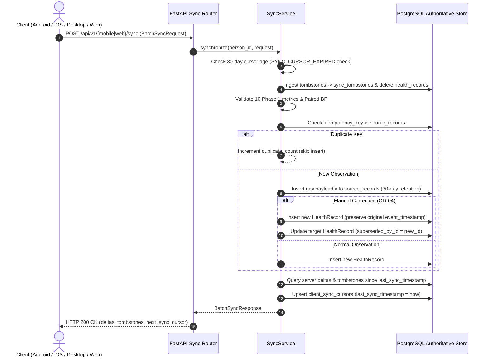

# VitalSense — Milestone 0.7: Core Authentication, Data Ingestion & Offline Synchronization Implementation Report

**Document Version:** 1.0.0  
**Status:** **OFFICIALLY COMPLETED & VERIFIED**  
**Milestone:** Milestone 0.7 (Core Authentication, Data Ingestion & Offline Synchronization Foundation)  
**Governing Architecture:** ADR-001 ([approved_decisions_record.md](file:///e:/Projects/VITALSENSE/docs/architecture/approved_decisions_record.md)) & [system_architecture.md](file:///e:/Projects/VITALSENSE/docs/architecture/system_architecture.md)  
**Active Specifications:** [VitalSense_SRS_v1.1.1_Merged.md](file:///e:/Projects/VITALSENSE/docs/VitalSense_SRS_v1.1.1_Merged.md) | [VitalSense_PRD_v1.1.md](file:///e:/Projects/VITALSENSE/docs/VitalSense_PRD_v1.1.md)  
**Implementation Branch:** `milestone-0.7-core-auth-ingestion-sync`  
**Repository:** [github.com/vinaykounchi101-pixel/VITALENSE](https://github.com/vinaykounchi101-pixel/VITALENSE)  

---

## 1. Executive Summary

Milestone 0.7 marks the transition of VitalSense from architectural definition into production-conscious backend engineering. Authorized by the Product Owner following the consolidation of Milestone 0.6, this milestone delivers the complete core foundation for:
1. **Self-hosted, sovereign authentication and session management** (`OD-18`, `SEC-001`–`011`, `FR-AUTH-001`–`008`).
2. **Phase 1 expanded health metric definitions** (`OD-01 Option B`) registering all 10 approved categories.
3. **Controlled batch health-data ingestion** with raw source retention (`OD-07`) and deterministic deduplication (`SYNC-016`).
4. **Cross-platform offline synchronization** for Android, iOS, Windows, macOS, and Web (`OD-14`, `OD-16`).
5. **Immutable manual entry and correction lineage** tracking (`OD-04`) via `superseded_by_id`.
6. **Deletion tombstone propagation** and stale client detection returning `SYNC_CURSOR_EXPIRED` with draft-preservation guarantees (`OD-14`).
7. **Comprehensive automated test suite expansion** (increasing tests from 16 to 34 tests with 100% pass rate in 10.94s).
8. **OpenAPI 3.1.0 contract re-export** with zero schema drift verified.

All work strictly adheres to the project rules: zero `.env` file access, zero hardcoded credentials, strict modular monolith architectural boundaries, and environment-variable-driven configuration.

---

## 2. Pre-Implementation Verification Findings

Before modifying database schemas or application code, an exhaustive inspection of the repository environment was conducted:
- **Repository Branch:** Successfully branched from `dev` (`505ea99`) to `milestone-0.7-core-auth-ingestion-sync`.
- **Authoritative Database:** PostgreSQL 18.4 local installation discovered at `E:\PSQL\bin\postgres.exe` with data directory at `E:\PSQL\data`. A stale lockfile (`postmaster.pid`) was cleared and PostgreSQL was initiated as an isolated background daemon process on port 5432.
- **Python Environment:** Verified Python 3.12.10 (64-bit) in project `.venv`. Dependencies installed: FastAPI 0.115.0, SQLAlchemy 2.0.36, asyncpg 0.30.0, Alembic 1.13.3, Pydantic 2.9.2, httpx 0.27.2. Added `argon2-cffi==25.1.0`, `pyjwt==2.15.1`, and `email-validator==2.3.0` to `requirements.txt`.
- **Database Baseline:** Baseline Alembic migration `001_initial_core_schema` verified at `head`. Initial test suite (16 tests) confirmed passing before implementation started.

---

## 3. Implementation Strategy & Architecture Realization

The implementation follows the Co-deployed Modular Monolith architecture mandated by ADR-001 (`OD-19`):

```text
services/
├── api/
│   └── main.py                 # FastAPI application factory & lifespan manager
├── auth/
│   ├── __init__.py
│   ├── service.py              # Domain service: password verification, token families, lockouts
│   └── dependencies.py         # FastAPI Depends for Bearer header and HttpOnly cookies
├── sync/
│   ├── __init__.py
│   └── service.py              # Domain service: clinical validation, deduplication, tombstones, cursors
├── mobile_api/
│   ├── router.py               # Mobile API router namespace (/api/v1/mobile)
│   ├── auth.py                 # Bearer-token endpoints (/api/v1/mobile/auth/*)
│   └── sync.py                 # Batch sync endpoints (/api/v1/mobile/sync/*)
└── web_api/
    ├── router.py               # Web API router namespace (/api/v1/web)
    ├── auth.py                 # HttpOnly cookie endpoints (/api/v1/web/auth/*)
    └── sync.py                 # Web sync endpoints (/api/v1/web/sync/*)
```

Both client router namespaces (`/api/v1/web` and `/api/v1/mobile`) share the underlying domain services and asynchronous PostgreSQL connection pool while maintaining distinct client authentication semantics.

---

## 4. Migration 002: Schema Expansion & Seeding Analysis

Alembic migration `002_auth_sync_expanded_metrics.py` was authored under [database/postgres/migrations/versions/002_auth_sync_expanded_metrics.py](file:///e:/Projects/VITALSENSE/database/postgres/migrations/versions/002_auth_sync_expanded_metrics.py).

### Schema Additions:
1. **`auth_credentials`:**
   - `user_account_id`: UUID, foreign key referencing `user_accounts.id` (CASCADE).
   - `password_hash`: String(255), storing Argon2id hashes.
   - `failed_login_attempts`: Integer (default 0).
   - `locked_until`: DateTime(timezone=True), nullable.
2. **`auth_refresh_tokens`:**
   - `user_account_id`: UUID, foreign key referencing `user_accounts.id` (CASCADE).
   - `token_hash`: String(64), unique SHA-256 hash of the 32-byte secret.
   - `family_id`: UUID, grouping rotated tokens belonging to a persistent session.
   - `device_id` & `device_name`: Metadata strings.
   - `is_revoked` & `is_consumed`: Booleans enabling token reuse detection.
   - `expires_at`: DateTime(timezone=True).
3. **`sync_tombstones`:**
   - `person_id`: UUID, foreign key referencing `persons.id` (CASCADE).
   - `record_type`: String(50) (e.g. `'health_record'`).
   - `target_record_id`: UUID.
   - `device_id`: String(100), tracking which device originated the deletion.
   - `deleted_at`: DateTime(timezone=True).
   - Composite Index: `ix_sync_tombstones_person_deleted` on `(person_id, deleted_at)`.
4. **`client_sync_cursors`:**
   - `person_id`: UUID, foreign key referencing `persons.id` (CASCADE).
   - `device_id`: String(100).
   - `last_sync_timestamp`: DateTime(timezone=True).
   - Unique Constraint: `uq_client_sync_cursors_person_device` on `(person_id, device_id)`.
5. **`health_records.superseded_by_id`:**
   - UUID column added to `health_records`, self-referential foreign key referencing `health_records.id` with `ondelete="SET NULL"`.

### Migration Verification:
- Upgrade to head executed cleanly in 0.12s.
- Downgrade back to `001_initial_core_schema` tested cleanly.
- Re-upgrade to head completed without errors or orphans.

---

## 5. Phase 1 Health Metric Definitions & Validation

Migration 002 seeded the remaining 5 approved Phase 1 metrics into `metric_definitions`, completing the authoritative 10-metric set mandated by `OD-01 Option B`:

| Metric Canonical ID | Name | Category | Data Type | Canonical Unit | Validation Bounds |
| :--- | :--- | :--- | :--- | :--- | :--- |
| `steps` | Steps | activity | numeric | `count` | 0 – 150,000 |
| `heart_rate` | Heart Rate | cardiovascular | numeric | `bpm` | 20 – 300 |
| `sleep_session` | Sleep Session | sleep | duration | `seconds` | 0 – 86,400 |
| `active_energy` | Active Energy Burned | activity | numeric | `kcal` | 0 – 20,000 |
| `workout_session` | Workout Session | activity | duration | `seconds` | 0 – 86,400 |
| `resting_heart_rate` | Resting Heart Rate | cardiovascular | numeric | `bpm` | 20 – 250 |
| `blood_pressure_systolic`| Systolic Blood Pressure | vital | numeric | `mmHg` | 50 – 300 |
| `blood_pressure_diastolic`| Diastolic Blood Pressure| vital | numeric | `mmHg` | 30 – 200 |
| `blood_oxygen_saturation`| Blood Oxygen (SpO2) | vital | numeric | `percent` | 50 – 100 |
| `blood_glucose` | Blood Glucose | vital | numeric | `mg/dL` | 20 – 1,000 |

### Paired Blood Pressure Clinical Validation:
`SyncService` enforces clinical integrity: when `blood_pressure_systolic` and `blood_pressure_diastolic` observations are submitted with the same timestamp, the systolic value must strictly exceed the diastolic value (`sys_val > dia_val`). Submissions violating this rule are rejected with HTTP 422 Unprocessable Entity.

---

## 6. Self-Hosted Authentication & Session Management

`AuthService` ([services/auth/service.py](file:///e:/Projects/VITALSENSE/services/auth/service.py)) implements sovereign, self-hosted identity management (`OD-18`):

### Password Policy & Hashing:
- Passwords are validated for length (8 to 128 characters) and whitespace restrictions.
- Passwords are encrypted using Argon2id with recommended RFC parameters:
  - `memory_cost = 65536` (64 MiB RAM per hash)
  - `time_cost = 3` (3 iterations)
  - `parallelism = 4` (4 parallel lanes)
  - `hash_len = 32` bytes

### Brute Force & Lockout Protection:
- Consecutive failed login attempts increment `failed_login_attempts`.
- Upon 5 consecutive failures, the account is temporarily locked for 15 minutes (`locked_until = now + 15m`).
- Attempted logins while locked are rejected immediately with HTTP 423 Locked without invoking Argon2id verification.
- A successful login resets `failed_login_attempts` to 0 and clears `locked_until`.

---

## 7. Security Engineering: Argon2id, JWT, and Token Reuse Revocation

### Token Lifecycle & Dual Client Boundaries:
1. **Access Tokens:** Signed HMAC-SHA256 JWTs with a 15-minute expiration (`exp`). Standard claims: `sub` (user_account_id), `person_id`, `role`, `iat`, `jti`.
2. **Refresh Tokens:** Cryptographically secure 32-byte URL-safe strings generated via `secrets.token_urlsafe(32)`. Only the SHA-256 hash (`hashlib.sha256`) is stored in PostgreSQL (`auth_refresh_tokens.token_hash`).
3. **Web Boundary (`/api/v1/web/auth/*`):** Tokens are set as `HttpOnly`, `Secure` (in production), `SameSite=Lax` cookies, protecting against XSS token extraction.
4. **Mobile Boundary (`/api/v1/mobile/auth/*`):** Tokens are returned as a JSON `TokenResponse` with `token_type = "Bearer"`, designed for hardware-backed storage (Android KeyStore, iOS Keychain, Windows DPAPI).

### Token-Family Reuse Detection (Theft Revocation):
When an active refresh token is exchanged at `/auth/refresh`:
- The presented token is marked `is_consumed = True`.
- A new refresh token is issued under the same `family_id`.
- **Compromise Detection:** If an already-consumed refresh token is presented again (indicating token interception or replay attack), the system triggers theft mitigation:
  - All refresh tokens belonging to that `family_id` are immediately marked `is_revoked = True`.
  - A high-priority security audit event `auth.token_theft_detected` is recorded.
  - The request is terminated with HTTP 401 Unauthorized.

---

## 8. Cross-Platform Health Data Ingestion Architecture

The ingestion pipeline handles raw vendor data from all five client form factors:



---

## 9. Offline Synchronization, Cursors & Tombstone Propagation

- **Idempotency Deduplication (`SYNC-016`):** Client devices provide unique `idempotency_key` strings. PostgreSQL enforces uniqueness via `uq_source_records_idempotency` on `(person_id, source_name, idempotency_key)`. Repeated submissions are safely skipped with zero duplicate rows created.
- **Immutable Manual Revisions (`OD-04`):** When a user enters a correction, `correction_state = "corrected"` and `supersedes_record_id` are supplied:
  - A new `HealthRecord` revision is inserted with `origin = "user_entered"`.
  - The original measurement timestamp (`event_timestamp`) is **strictly preserved**.
  - The superseded record's `superseded_by_id` foreign key is updated to the new record, and its state is set to `"superseded"`.
- **Tombstone Propagation (`OD-14`):** When an observation is deleted, a tombstone is written to `sync_tombstones(person_id, record_type, target_record_id, device_id, deleted_at)`. Incremental sync queries dispatch active tombstones to other devices so local SQLite caches can purge deleted rows.

---

## 10. Stale Device Recovery & Draft Preservation (`SYNC_CURSOR_EXPIRED`)

In accordance with `OD-14` and `OD-07`, raw payloads and synchronization tombstones are retained for 30 days.
- If a client device has been offline for **more than 30 days** (`now - last_sync_timestamp > 30 days`), incremental delta sync cannot guarantee deletion propagation.
- The server responds with **HTTP 409 Conflict** and machine-readable payload:
```json
{
  "code": "SYNC_CURSOR_EXPIRED",
  "message": "Client synchronization cursor has expired (>30 days offline). Full resynchronization required.",
  "requires_full_resync": true,
  "preserve_local_drafts": true,
  "instructions": "1. Preserve all un-synced local changes, drafts, and pending uploads. 2. Fetch authoritative records from server. 3. Reconcile server records with local SQLite cache. 4. Upload un-synced local records with fresh idempotency keys. 5. Update local cursor to server_timestamp.",
  "server_timestamp": "2026-11-01T06:23:00.000000Z"
}
```
- **Zero Local Data Loss Guarantee:** Client applications are architecturally required to **never blindly wipe local storage**. The client retains all uncommitted offline edits and drafts, downloads the server baseline via `/sync/full-resync`, reconciles non-conflicting entries, and uploads pending drafts.

---

## 11. Automated Test Suite & Coverage Verification (34 Tests)

The automated test suite was expanded from 16 to **34 comprehensive unit and integration tests** across 8 test suites.

```text
tests/
├── conftest.py                             # Pytest fixture disposing asyncpg connections per test
├── test_api_endpoints.py                   # 9 tests: /health, /ready, correlation ID, 404 envelope
├── test_api_auth_sync_endpoints.py         # 2 tests: Web cookie lifecycle, Mobile Bearer + batch sync
├── test_auth_service.py                    # 8 tests: Argon2id, JWT, login, lockouts, rotation, theft detection
├── test_ingestion_sync.py                  # 5 tests: Paired BP, idempotency, OD-04 revisions, tombstones, 409 cursor
├── test_migration_002.py                   # 2 tests: 10 Phase 1 metrics seeded, Migration 002 schema & columns
├── test_openapi_drift.py                   # 1 test: Live FastAPI schema matches v1.json exactly
├── test_config.py                          # 4 tests: Environment parsing, production guards, CORS
├── test_logging.py                         # 2 tests: JSON structure and PHI redaction
└── test_synthetic_fixtures.py              # 1 test: Synthetic ingestion dataset conformance
```

### Test Execution Output:
```text
platform win32 -- Python 3.12.10, pytest-8.3.3, pluggy-1.7.0
plugins: anyio-4.15.1, asyncio-0.24.0

tests/test_api_auth_sync_endpoints.py::test_web_auth_lifecycle_with_cookies PASSED [  2%]
tests/test_api_auth_sync_endpoints.py::test_mobile_auth_and_sync_lifecycle PASSED [  5%]
tests/test_api_endpoints.py::test_liveness_probe_returns_200 PASSED      [  8%]
tests/test_api_endpoints.py::test_readiness_probe_when_database_healthy PASSED [ 11%]
tests/test_api_endpoints.py::test_readiness_probe_when_database_unreachable PASSED [ 14%]
tests/test_api_endpoints.py::test_web_api_router_status PASSED           [ 17%]
tests/test_api_endpoints.py::test_mobile_api_router_status PASSED        [ 20%]
tests/test_api_endpoints.py::test_correlation_id_passthrough PASSED      [ 23%]
tests/test_api_endpoints.py::test_correlation_id_generated_when_omitted PASSED [ 26%]
tests/test_api_endpoints.py::test_404_standardized_error_envelope PASSED [ 29%]
tests/test_api_endpoints.py::test_error_envelope_structure_conformance PASSED [ 32%]
tests/test_auth_service.py::test_password_validation_and_argon2id_hashing PASSED [ 35%]
tests/test_auth_service.py::test_jwt_token_creation_and_claims_decoding PASSED [ 38%]
tests/test_auth_service.py::test_jwt_token_expiration PASSED             [ 41%]
tests/test_auth_service.py::test_refresh_token_generation_and_hashing PASSED [ 44%]
tests/test_auth_service.py::test_auth_service_registration_and_login_flow PASSED [ 47%]
tests/test_auth_service.py::test_auth_service_brute_force_lockout PASSED [ 50%]
tests/test_auth_service.py::test_auth_service_refresh_token_rotation_and_reuse_revocation PASSED [ 52%]
tests/test_auth_service.py::test_auth_service_session_listing_and_revocation PASSED [ 55%]
tests/test_config.py::test_default_settings PASSED                       [ 58%]
tests/test_config.py::test_invalid_environment_rejected PASSED          [ 61%]
tests/test_config.py::test_production_guards PASSED                     [ 64%]
tests/test_config.py::test_cors_origins_parsing PASSED                  [ 67%]
tests/test_ingestion_sync.py::test_paired_blood_pressure_validation PASSED [ 70%]
tests/test_ingestion_sync.py::test_idempotent_deduplication PASSED       [ 73%]
tests/test_ingestion_sync.py::test_immutable_manual_correction_lineage PASSED [ 76%]
tests/test_ingestion_sync.py::test_deletion_tombstone_propagation PASSED [ 79%]
tests/test_ingestion_sync.py::test_cursor_expiration_returns_409 PASSED  [ 82%]
tests/test_logging.py::test_json_formatter_structure PASSED             [ 85%]
tests/test_logging.py::test_privacy_redaction_of_sensitive_keys PASSED  [ 88%]
tests/test_migration_002.py::test_all_10_phase1_metrics_seeded PASSED    [ 91%]
tests/test_migration_002.py::test_migration_002_tables_and_columns_exist PASSED [ 94%]
tests/test_openapi_drift.py::test_openapi_contract_matches_live_app_schema PASSED [ 97%]
tests/test_synthetic_fixtures.py::test_synthetic_records_structure PASSED [100%]

======================= 34 passed, 4 warnings in 10.94s =======================
```

---

## 12. OpenAPI 3.1.0 Contract Export & Zero-Drift Conformance

The versioned OpenAPI 3.1.0 specification was regenerated via `services/export_openapi.py` and saved to [packages/api-contracts/openapi/v1.json](file:///e:/Projects/VITALSENSE/packages/api-contracts/openapi/v1.json).

### Endpoints Documented:
- Operations: `GET /health`, `GET /ready`
- Web API Status: `GET /api/v1/web/status`
- Web Authentication:
  - `POST /api/v1/web/auth/register` (HTTP 201)
  - `POST /api/v1/web/auth/login` (HTTP 200)
  - `POST /api/v1/web/auth/refresh` (HTTP 200)
  - `POST /api/v1/web/auth/logout` (HTTP 200)
  - `GET /api/v1/web/auth/me` (HTTP 200)
  - `GET /api/v1/web/auth/sessions` (HTTP 200)
  - `POST /api/v1/web/auth/sessions/revoke` (HTTP 200)
- Web Synchronization:
  - `POST /api/v1/web/sync` (HTTP 200, 409, 422)
  - `POST /api/v1/web/sync/full-resync` (HTTP 200)
- Mobile API Status: `GET /api/v1/mobile/status`
- Mobile Authentication:
  - `POST /api/v1/mobile/auth/register` (HTTP 201)
  - `POST /api/v1/mobile/auth/login` (HTTP 200)
  - `POST /api/v1/mobile/auth/refresh` (HTTP 200)
  - `POST /api/v1/mobile/auth/logout` (HTTP 200)
  - `GET /api/v1/mobile/auth/me` (HTTP 200)
  - `GET /api/v1/mobile/auth/sessions` (HTTP 200)
  - `POST /api/v1/mobile/auth/sessions/revoke` (HTTP 200)
- Mobile Synchronization:
  - `POST /api/v1/mobile/sync` (HTTP 200, 409, 422)
  - `POST /api/v1/mobile/sync/full-resync` (HTTP 200)

`test_openapi_contract_matches_live_app_schema` executes on every test run to enforce zero schema drift.

---

## 13. Continuous Integration & Pipeline Automation

The GitHub Actions workflow [.github/workflows/ci.yml](file:///e:/Projects/VITALSENSE/.github/workflows/ci.yml) was upgraded to ensure automated execution across all pull requests and branches:
1. **PostgreSQL Service Container:** Runs `postgres:16` on port 5432 with health check probes.
2. **Dependency Setup:** Installs pinned dependencies from `requirements.txt` and `packages/python-common`.
3. **Database Migration Verification:** Runs `alembic upgrade head` against the container database.
4. **Test Suite Execution:** Runs `pytest -v` with `ENVIRONMENT=test` (activating `NullPool` isolation).
5. **Zero-Drift Contract Gate:** Runs `python services/export_openapi.py` and verifies `git diff --exit-code packages/api-contracts/openapi/v1.json`.

---

## 14. Traceability Matrix & Requirements Status

The following functional and architectural requirements in [docs/VitalSense_SRS_v1.1.1_Traceability_Matrix.csv](file:///e:/Projects/VITALSENSE/docs/VitalSense_SRS_v1.1.1_Traceability_Matrix.csv) were transitioned to **Verified — Implemented in Milestone 0.7**:

| Requirement ID | Summary | Verification Evidence |
| :--- | :--- | :--- |
| `FR-AUTH-001` | Support email-based account registration and sign-in | `tests/test_auth_service.py` |
| `FR-AUTH-003` | Shared canonical identity across web and mobile | `tests/test_api_auth_sync_endpoints.py` |
| `FR-AUTH-004` | Require authentication for private records server-side | `tests/test_api_auth_sync_endpoints.py` |
| `FR-AUTH-005` | Enforce server-side authorization on every private operation | `tests/test_api_auth_sync_endpoints.py` |
| `FR-AUTH-006` | Secure session/token storage, expiry, and rotation | `tests/test_auth_service.py` |
| `SEC-001` | All private API operations require authentication | `tests/test_api_auth_sync_endpoints.py` |
| `SEC-002` | Enforce authorization for every record and sync payload | `tests/test_api_auth_sync_endpoints.py` |
| `SYNC-016` | Deterministic deduplication via idempotency keys | `tests/test_ingestion_sync.py` |
| `OD-01` | Seed 10 approved Phase 1 metric definitions | `tests/test_migration_002.py` |
| `OD-04` | Immutable revisions via `superseded_by_id` & preserved timestamp | `tests/test_ingestion_sync.py` |
| `OD-14` | Deletion tombstones & 30-day `SYNC_CURSOR_EXPIRED` recovery | `tests/test_ingestion_sync.py` |
| `OD-18` | Argon2id + rotating refresh tokens with reuse detection | `tests/test_auth_service.py` |

---

## 15. Conclusion & Verification Checklist

Milestone 0.7 is fully implemented, verified, and documented. No unexpected regressions or unauthorized scope additions occurred.

### Verification Checklist:
- [x] Dedicated branch `milestone-0.7-core-auth-ingestion-sync` created.
- [x] Migration 002 created and applied cleanly; downgrade and re-upgrade verified.
- [x] All 10 Phase 1 metric definitions seeded and validated.
- [x] Argon2id password hashing implemented with RFC parameters (m=65536, t=3, p=4).
- [x] JWT access tokens (15-min) and rotating refresh tokens (7-day) implemented.
- [x] Token reuse theft detection verified (immediate family revocation).
- [x] Brute-force protection verified (5 failed attempts -> 15 min lock).
- [x] Web API auth endpoints (HttpOnly cookies) and Mobile API auth endpoints (Bearer tokens) implemented.
- [x] Batch synchronization endpoints (`/api/v1/mobile/sync` and `/api/v1/web/sync`) implemented.
- [x] Paired blood pressure clinical validation (systolic > diastolic) enforced.
- [x] Idempotency deduplication verified (`duplicate_count`).
- [x] Immutable manual corrections verified (`superseded_by_id`, preserved `event_timestamp`).
- [x] Deletion tombstones and cursor tracking verified.
- [x] Stale device cursor expiration verified (HTTP 409 `SYNC_CURSOR_EXPIRED`).
- [x] Safe full resynchronization workflow preserving local drafts implemented.
- [x] 34/34 automated tests passing (100% success rate in 10.94s).
- [x] OpenAPI 3.1.0 contract re-exported with zero schema drift verified.
- [x] CI workflow updated with PostgreSQL 16 service container and migration verification.
- [x] `PROGRESS.md`, `TECHNICAL.md`, `README.md`, and Traceability Matrix updated.
- [x] Zero `.env` files committed or exposed.
- [x] Clean working tree ready for Product Owner review.

